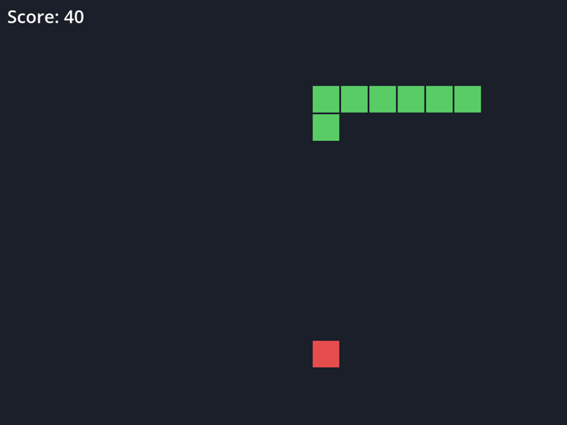

# Godot Project Template

A tooling template for a Godot 4 game's repository. It sets up everything around the game:
pinned tool versions, one setup command, formatters, linters, headless tests, a commit hook, a
release export and a C++ extension build. Start your game from it and the first commit already
has checks that pass on any computer.

It is not a game framework. A small Snake game is in it so every tool has something real to
run on; you replace it with your own. The game has a scene loader and a pause menu, and no
options menu, audio, save system or input remapping.



## What you get, and why

| Tool | Why it is here |
|---|---|
| [mise](https://mise.jdx.dev) | Installs every tool below, Godot included, at one exact version (`mise.toml`, checksums in `mise.lock`). Everyone on the project runs the same versions, and each job is one `mise run` task. |
| Godot 4.7 | The engine, pinned like any other tool, so the editor and the tests agree. |
| GDScript warnings as errors | `project.godot` turns the engine's warnings (untyped declarations, unused variables and the like) into errors, so the script will not run until it is fixed. |
| gdscript-formatter, gdlint | One lays GDScript out, the other checks naming and the order of a script's members. Reviews stop being about style. |
| [gdUnit4](https://github.com/godot-gdunit-labs/gdUnit4) | Tests, run in a headless engine. A run also fails on any engine error, warning or orphaned node it prints. |
| Commit hook | Checks layout and lints the changed files on every commit, so a broken commit is caught before it is shared. |
| godot-cpp, SCons, clang-format, clang-tidy | A working GDExtension build with one example class, for code too slow in script. [Removable](#removing-c) if you need no C++. |
| ruff, mypy | Format and check the Python scripts in `tools/` that the tasks run. |
| Export task | Builds a release for macOS, Windows or Linux, with the export templates downloaded and checksum-verified. |

[CHECKS.md](CHECKS.md) shows what each check reports when something is wrong.

## Start

You need [mise](https://mise.jdx.dev), git, and a C++ compiler: the Xcode command line tools on
macOS (`xcode-select --install`), the "Desktop development with C++" workload of Visual
Studio's Build Tools on Windows, or GCC or Clang on Linux. The compiler is only for the C++
class; the game itself opens and plays without it.

Clone the repository (or make your own from it), and in it run:

```
mise trust
mise run setup
```

mise runs the tasks in a `mise.toml` only once you have trusted its folder, so `mise trust`
comes first, once per clone. `mise run setup` then installs the pinned tools, turns on the
commit hook, builds the C++ class and imports the project. In a folder that is not yet a git
repository it skips the hook; run it again after `git init`.

## Tasks

| Task | What it does |
|---|---|
| `mise run play` | Opens the game at its title screen. |
| `mise run bot` | Runs the game with the C++ bot playing it, one game after another. |
| `mise run check` | Everything below: layout, lint and every test. Run it before you share a change. |
| `mise run format` | Lays out GDScript, Python and C++, then loads every script to prove it still parses. |
| `mise run format-check` | The same, changing nothing; fails if anything would change. |
| `mise run lint` | gdlint, ruff, mypy and clang-tidy. |
| `mise run test` | Builds the C++ class, then runs every `tests/test_*.gd`. To run some: `mise run test -- snake_game '*scene'`. Reports go to `reports/`. |
| `mise run build` | Builds the C++ class into `bin/`, downloading godot-cpp first if it is missing. |
| `mise run export-templates` | Downloads the engine's export templates (about 1.3 GB), once. |
| `mise run export` | Builds a release for this computer's platform into `build/`. Needs the export templates. The macOS build is ad-hoc signed, not notarized. |

Each platform's export needs that platform's C++ library, so each is exported on its own
computer.

## Make it yours

1. **Name.** Set `config/name` in `project.godot`. The engine names the saved-data folder
   (`user://`) after it.
2. **Export details.** In `export_presets.cfg`, set the bundle identifier
   (`com.hairballstudios.godotprojecttemplate`), the copyright lines, the product name, the
   version numbers and the file name in each `export_path`.
3. **Icon.** Replace `icon.svg`.
4. **The game.** Replace what is in `scenes/`, `scripts/`, `resources/` and `tests/` with your
   own, and the screenshot in `docs/`. The scene loader and the pause menu (and their tests)
   do not depend on Snake.
5. **The C++ library.** It is called `game`. To rename it, change `libgame` in
   `native/SConstruct` and `bin/game.gdextension`, and `game_library_init` in
   `bin/game.gdextension` and `native/src/register_types.cpp`. Or [remove it](#removing-c).
6. **Licences.** [LICENSE](LICENSE) (MIT) covers the template; choose your game's own, and keep
   the template's notice with the template code you keep. gdUnit4 has its own in
   `addons/gdUnit4/LICENSE`. A game made with Godot must also ship the engine's licence text
   and third-party notices where a player can find them: see
   [Complying with licenses](https://docs.godotengine.org/en/stable/about/complying_with_licenses.html).
   The template has no credits screen.
7. **This README**, and [CONTRIBUTING.md](CONTRIBUTING.md), which is about the template.

## What is in the repository

| Path | What it holds |
|---|---|
| `scenes/`, `scripts/`, `resources/` | The sample game, the scene loader and the pause menu. |
| `tests/` | The gdUnit4 tests: the rules, the saved files, the scenes driven by key and button presses, and whole games played by the bot. |
| `tools/` | The Python scripts behind the tasks. `engine.py` runs the pinned Godot even when another `godot` comes first on your path. |
| `native/`, `bin/` | The C++ source, and the built library with the `.gdextension` file that tells the engine where it is. |
| `addons/gdUnit4/` | gdUnit4 6.2.3, copied in unchanged. No formatter or linter is pointed at it. |
| `.githooks/` | The commit hook. |
| `.github/workflows/main.yml` | On every push to `main`, runs `setup`, `check`, `export-templates` and `export` on macOS, Windows and Linux, and keeps each release build for 7 days. |
| `mise.toml`, `mise.lock`, `.mise/` | Tool versions, their checksums, and the tasks. |
| `.gdlintrc`, `ruff.toml`, `mypy.ini`, `.clang-format`, `.clang-tidy`, `.editorconfig`, `.gitattributes` | Layout and lint rules. |
| `export_presets.cfg` | The export settings for the three platforms. |

The files are grouped by kind. Godot's
[project organization guide](https://docs.godotengine.org/en/stable/tutorials/best_practices/project_organization.html)
suggests the other way, each scene's files in a folder of their own. The template groups by kind
because half its scripts belong to no scene, and because the checks take folders. A game with
many scenes may do better grouped by feature: to regroup, change the folder names in the
`format`, `format-check` and `lint` tasks in `mise.toml`, in `FOLDERS` in
`tools/load_all_scripts.gd`, and in the test glob in `tools/run_tests.py`.

### The sample game

Snake, written to show the practices the checks enforce: typed GDScript, rules kept apart from
scenes, typed signals, a `Resource` for tuning, and input actions that take keyboard and gamepad.

| File | What it is |
|---|---|
| `scripts/snake_game.gd` | The rules, with no scene in them. |
| `scripts/game_settings.gd` | A `Resource` of tuning numbers, saved in `resources/default_settings.tres`. |
| `scripts/high_score.gd`, `scripts/preferences.gd` | The best score and the chosen speed, each kept in a config file. `Preferences` is an autoload. |
| `scripts/board_view.gd`, `scripts/hud.gd` | Two scenes that only show things. |
| `scripts/main.gd`, `scripts/title.gd` | The game scene (input, the timer, the bot) and the title screen. |
| `scripts/scene_loader.gd` | The `SceneLoader` autoload. `SceneLoader.change_to(path)` fades out, loads the scene on another thread, swaps it in and fades back. |
| `scripts/pause_menu.gd` | A pause menu to add to any scene: the `pause` action stops the scene tree and shows Resume and Title screen buttons. |

| | Keyboard | Gamepad |
|---|---|---|
| Turn | Arrow keys or W, A, S, D | D-pad or left stick |
| Pause menu, and back out of it | P or Escape | Start |
| Play again, once a game ends | Enter or Space | A (bottom face button) |
| Back to the title | M | Back |

## C++

`native/` holds one class, `SnakeBot` (`native/src/snake_bot.cpp`), built with
[godot-cpp](https://github.com/godotengine/godot-cpp) into `bin/`. It plays the game by
searching the whole board each step, the kind of work worth moving out of script.
`mise run bot` shows it playing, and the tests use it to play whole games.

To add a class: a header and a source file in `native/src`, a line in `register_types.cpp`, and
a reference page in `native/doc_classes` (the build compiles it into the editor's help).

The game looks the bot up by name only when asked for it, so the project opens in the editor
and plays before the library is built. Until then the engine reports once at start-up that it
cannot open the library, and `--bot` says to run `mise run build`. The tests, the lint and the
export need the library, so those tasks build it first.

### Removing C++

1. In `scripts/main.gd`, delete `BOT_CLASS`, `_bot`, `play_with_bot`, `_new_bot`,
   `_restart_after_delay` and their uses. Delete the `--bot` branch in `scripts/title.gd`, the
   two bot tests in `tests/test_main_scene.gd`, and `tests/test_snake_bot.gd` (or write the bot
   in GDScript).
2. Delete `native/`, `bin/`, `tools/clang_format.py`, `tools/clang_tidy.py` and
   `tools/fetch_godot_cpp.py`.
3. In `mise.toml`, delete the `bot`, `build` and `fetch-godot-cpp` tasks, the `build`
   dependencies of `play`, `test` and `lint`, the `fetch-godot-cpp` dependency of `export`, the
   `clang_format.py` and `clang_tidy.py` lines of `format`, `format-check` and `lint`, the
   `scons` and `clang` pins, `GODOT_CPP_REF`, and the `mise run build` step of `setup`.
4. In `tools/export.py`, delete the `scons` step and the `arch` line above it.

## Versions

The template pins Godot 4.7. To move to another minor version, change these together:

- `godot` in `mise.toml`, and `config/features` in `project.godot`.
- `api_version` in `native/SConstruct`, and `compatibility_minimum` in `bin/game.gdextension`.
- `GODOT_CPP_REF` in `mise.toml`, if the new version needs a newer godot-cpp; then delete
  `native/godot-cpp` and run `mise run build`.

`GODOT_CPP_REF` is the commit of godot-cpp's `10.0.0-stable` tag. Since 10.0 godot-cpp has its
own version numbers, and one release builds for several Godot versions through `api_version`.
An extension built for one minor version loads in that version and later ones.

To move gdUnit4 to another release, replace `addons/gdUnit4` with the same folder from that
release's source, and run `mise run test`.
